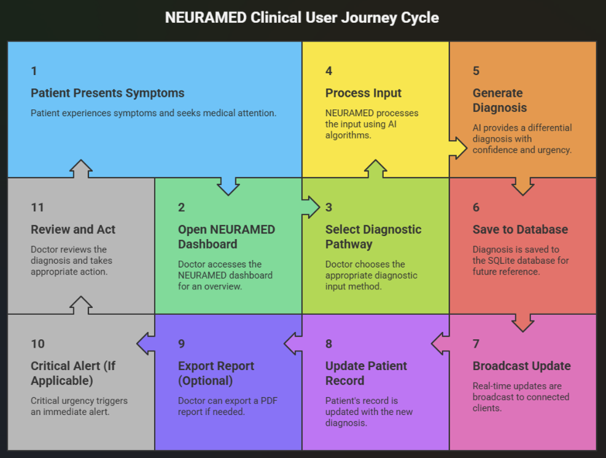

# NEURAMED

**AI diagnostic research demo: three agents, one suggested diagnosis.**

> **Not a medical device.** NEURAMED is a research and educational demo. It has no FDA, CE or other regulatory clearance, its outputs are not clinically validated, and it must not be used to diagnose or treat anyone. Sample data in this repo is synthetic.

I built NEURAMED because I wanted to see what happens when you throw real AI at clinical workflows instead of just wrapping a chatbot in a hospital skin. Voice symptoms in, differential diagnosis out. Drop a CT scan, get annotated anomalies. Upload a medical report PDF, get structured intelligence. All three agents run on LLaMA 3 70B via Groq, persist everything to a database, and broadcast results over WebSocket in real-time.

This started as a weekend idea and turned into something I'm genuinely proud of.



---

## Stack

**Backend** — FastAPI, SQLAlchemy, Pydantic v2, Groq (LLaMA 3 70B), ElevenLabs Scribe, OpenCV, PyTesseract, ReportLab, WebSocket, Uvicorn

**Frontend** — React 18, TypeScript, Vite, Three.js, Framer Motion, TanStack Query, Tailwind, Recharts, Axios

---

## The Three Agents

**Voice Diagnosis** — Accepts spoken or typed symptoms. Transcribes via ElevenLabs, runs it through a LLaMA 3 prompt, returns a suggested differential diagnosis with confidence scores, urgency classification, and treatment recommendations.

**Imaging AI** — Accepts CT/MRI/X-Ray/Ultrasound images. Full OpenCV pipeline (CLAHE, denoising, Otsu thresholding, contour analysis) detects anomaly regions. LLaMA 3 interprets the findings into a radiological report.

**OCR Reports** — Accepts PDF or scanned medical reports. PyTesseract extracts text, regex parser structures it into clinical sections, LLaMA 3 generates summary + key findings + abnormal flags.

---

## Run locally

```bash
# backend
cd backend
python -m venv venv && source venv/bin/activate
pip install -r requirements.txt
cp .env.example .env  # add your Groq + ElevenLabs keys
alembic upgrade head  # create the database tables (SQLite by default)
uvicorn main:app --reload --port 8000

# frontend (separate terminal)
cd neural_care_hub_main
npm install
echo "VITE_API_BASE_URL=http://localhost:8000" > .env.local
npm run dev
```

Needs Python 3.11+, Node 20.19+ (CI uses Node 24), and Tesseract OCR installed. Without a `GROQ_API_KEY` the AI routes return a clear 503 "not configured" message instead of a result.

```bash
# tests (from the repo root)
(cd backend && pytest -m "not network")   # backend; "network" tests call free public APIs
(cd neural_care_hub_main && npm test && npm run build)
```

---

## Deploy

Backend deploys to Railway (Procfile + nixpacks.toml included). Frontend deploys to Vercel — just point it at `neural_care_hub_main/`.

Set `VITE_API_BASE_URL` to your Railway URL and `ALLOWED_ORIGINS` on the backend to your Vercel domain.

---

## Disclaimer

NEURAMED is a research and educational project. It is not a medical device and is not certified, cleared or approved for clinical use. All AI outputs must be reviewed by a qualified medical professional. Do not use as a substitute for professional medical advice.

---

Built by **ShAuRyA Punj** — [GitHub](https://github.com/ShAuRyA-Noodle)

MIT License
